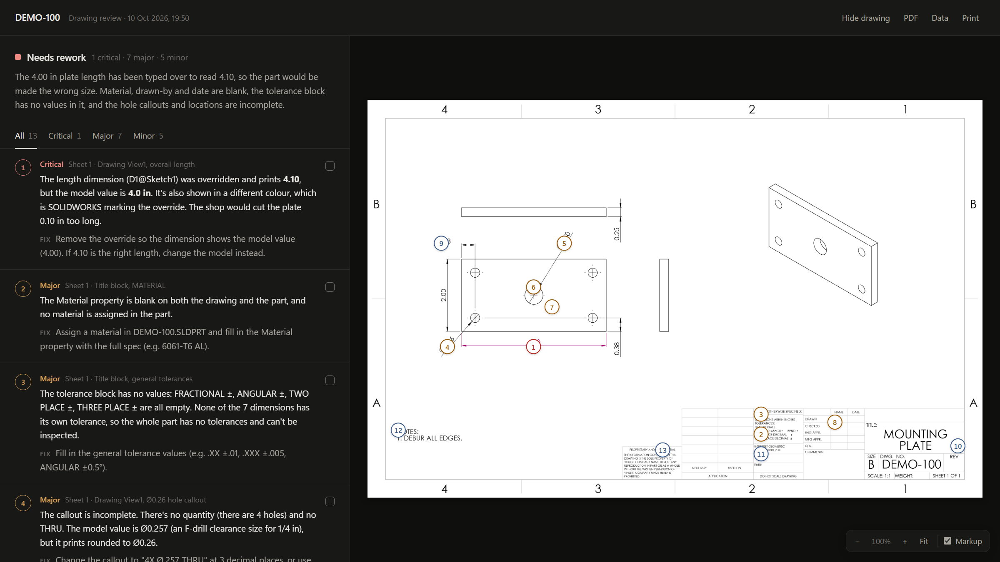

# Review with Claude

**A one-click drafting review for SOLIDWORKS drawings, done by Claude.**

Run the macro on an open drawing. A few minutes later a review opens in your browser: findings ranked Critical / Major / Minor, each one with a numbered balloon on the drawing where the problem is.

<!-- Screenshot: add docs/review.png and uncomment.

-->

Built for **SOLIDWORKS 2025** on **Windows**. Uses **Claude Code** (the default mode) or **Claude Desktop**.

---

## What it checks

The checklist lives in [`review-instructions.md`](review-instructions.md), and you can edit it freely. Out of the box it covers:

- **Title block:** part number, description, material, finish, revision, drawn by and date; scale and sheet count; the tolerance block.
- **Dimensions:** missing, duplicate or over-dimensioned features; sensible and consistent tolerances; complete hole callouts; overridden or dangling dimensions.
- **Views:** coverage, scales, section and detail labels, crowding, center marks.
- **Notes, GD&T and manufacturability:** general notes, datums that are referenced but never defined, valid feature control frames, inside corner radii, thread depths.
- **Assemblies:** BOM against balloons.

Claude doesn't have to read small print off a picture. The macro pulls the exact values out of SOLIDWORKS and gives Claude those alongside the PDF. A value that prints differently from what's stored (someone typed over a dimension) is flagged as Critical.

## How it works

```
SOLIDWORKS drawing
   │  macro (VBA)
   ├─► <drawing>.pdf          every sheet
   └─► drawing-data.md        the checklist, then every dimension, tolerance, note, GD&T frame,
                              datum, table, property and view, with sheet positions, plus
                              "pre-flags" (overridden/dangling dims, undefined datums, blank
                              title-block fields)
   │  run-review.ps1 → Claude Code, read-only, confined to the run folder
   └─► review.md  →  review.html   findings beside the drawing, one balloon per finding
```

Each run gets its own folder under `%TEMP%\ClaudeDrawingReview\`. Nothing is written next to your drawing, and run folders older than 14 days are deleted automatically.

---

## Setup

### Requirements

- Windows with SOLIDWORKS 2025.
- The [Claude Code CLI](https://docs.claude.com/en/docs/claude-code/setup), installed and **signed in**: run `claude` once in a terminal and log in. Needed for the default background mode.
  - Or [Claude Desktop](https://claude.ai/download) if you use one of the Desktop modes (see `LAUNCH_MODE` below).
- A Claude plan or API account. Reviews count toward its usage.

### Build the macro

The repo holds readable source. SOLIDWORKS runs a binary `.swp`, which you build once:

1. Clone or download this repo.
2. In SOLIDWORKS: **Tools → Macro → New…** and save it as `ClaudeReviewDrawing.swp` **in the repo folder**, next to `review-instructions.md` and `run-review.ps1`.
3. In the VBA editor, remove the empty default module.
4. Go to **File → Import File…** and choose `src\ClaudeReviewDrawing.bas`.
5. Under **Tools → References**, make sure *SOLIDWORKS 2025 Type Library* and *SOLIDWORKS 2025 Constant type library* are checked. New macros normally have both.
6. Run **Debug → Compile VBAProject**, then save and close.

**Tip:** add a toolbar button. Go to **Tools → Customize → Commands → Macro → New Macro Button**, pick the `.swp`, and set the method to `Main`.

### Run it

1. Open a drawing. It doesn't need to be saved; the review covers what's on screen.
2. Run the macro.
3. Keep working. `review.html` opens in your browser when Claude is done, usually within a few minutes.

## The report

- **Findings list (left):** sorted by severity, with tabs to filter it. Each finding has its location, the issue and a suggested fix, plus a **Fixed** checkbox that's remembered when you reopen the page.
- **Drawing (right):** every sheet, with a numbered balloon for each finding. Scroll to zoom, drag to pan, and double-click to fit. The **Markup** switch hides the balloons.
  - Click a finding and the drawing zooms to its balloon. Click a balloon and the list jumps to that finding.
  - Findings that aren't about one spot (e.g. missing general notes) get a dashed balloon in the list and none on the sheet.
- **Looks good** and **Questions** follow the findings. The page prints cleanly.

Claude places each balloon from a `Pin` column in its findings (x,y as percent of the sheet). Where it can, it uses the sheet positions the macro records for every view, dimension and note.

To ask follow-up questions, open a terminal in the run folder and run `claude --continue`.

---

## Settings

Settings are constants at the top of `src/ClaudeReviewDrawing.bas`. Edit the file, re-import it, and recompile.

| Setting | What it does | Default |
| --- | --- | --- |
| `LAUNCH_MODE` | How Claude is used (see below) | `2` |
| `OUTPUT_ROOT` | Where run folders go. Blank = `%TEMP%\ClaudeDrawingReview` | blank |
| `KEEP_DAYS` | Delete this macro's run folders older than this many days (`0` = keep all). Only folders that contain the macro's `.claude-review-run` marker are deleted | `14` |
| `INSTRUCTIONS_FILE` | Checklist file, looked up next to the `.swp` | `review-instructions.md` |
| `TITLE_PROPS` | Title-block properties that must not be blank. Checked on the drawing, then on the model, ignoring case and spaces | `PartNumber, Description, Revision, Material, DrawnBy, DrawnDate` |
| `MAX_TABLE_ROWS` | Table rows listed before a table is cut off | `150` |

### Launch modes

| Mode | What happens | Needs | Clicks |
| --- | --- | --- | --- |
| `2` *(default)* | Claude Code reviews in the background, then `review.html` opens | Claude Code CLI | none |
| `0` | A new session opens in Claude Desktop's **Code** tab, working in the run folder. The review appears in the chat | Claude Desktop | confirm the folder |
| `1` | A new Claude Desktop **Cowork** session opens with the files attached | Claude Desktop | **Attach**, once per file |
| `3` | A new Claude Desktop chat opens; the files are on your clipboard | Claude Desktop | **Ctrl+V** |
| `4` | Only the export folder opens; attach the files yourself | — | — |

Modes 0, 1 and 3 use Claude Desktop's [`claude://` links](https://support.claude.com/en/articles/14729294-open-claude-desktop-with-a-link). Desktop asks you to approve folders and files that arrive through a link; that's a security check, so it can't be skipped.

### Changing what Claude checks

Edit [`review-instructions.md`](review-instructions.md). You don't need to rebuild anything: it's read on every run and placed at the top of `drawing-data.md`. Add your shop's rules (standard notes, preferred tolerances, title-block conventions) under the checklist headings. Keep the **How to answer** section, because the report page reads that format.

---

## Privacy and security

**What leaves your machine.** The drawing PDF and `drawing-data.md` go to Anthropic, for Claude to read. That covers:
- every dimension, note, table and custom property;
- file names (not full paths).

Don't run it on drawings you're not allowed to share with a third-party service, e.g. under an NDA or export controls (ITAR/EAR). See [Anthropic's privacy policy](https://www.anthropic.com/legal/privacy) for how data is handled.

**What Claude can do in the background mode.** `run-review.ps1` starts Claude Code with:

```
claude -p --restricted --strict-mcp-config --tools Read --allowedTools Read
```

- `--tools Read`: Read is the only tool. Claude can't run commands, edit files or browse the web.
- `--restricted`: confines that tool to the run folder and ignores your user and project Claude Code settings.
- `--strict-mcp-config`: no MCP servers.

Claude's answer is written to `review.md` by the script, not by Claude.

**Text inside the drawing.** Notes, properties and table cells are drawing content. The checklist tells Claude to treat them as data and to report anything that reads like an instruction as a finding. Even so, check reviews of drawings from outside sources with care.

**`-ExecutionPolicy Bypass`.** The macro starts `run-review.ps1` with this so it runs on PCs where scripts are disabled by default. It applies to that one PowerShell process only. Group Policy and AppLocker still take precedence: on a locked-down PC the script may be blocked, and no review appears.

---

## Troubleshooting

| Symptom | Likely cause |
| --- | --- |
| A popup says Claude couldn't finish | The reason is in `claude-log.txt` in the run folder. The usual causes are that the CLI isn't signed in (run `claude` once) or that a plan limit was reached |
| Nothing ever opens in background mode | Scripts are blocked by policy on this PC (see above), or PowerShell couldn't start. Try `LAUNCH_MODE 0` or `1` |
| The page shows the PDF but no balloons | The sheet images come from Windows' built-in PDF renderer through Windows PowerShell 5.1, which the macro uses. Under PowerShell 7 the page falls back to the plain PDF |
| A compile error after importing | Check the two SOLIDWORKS references (step 5 of the build) |
| Title-block fields flagged blank but they're filled in | Your property names differ: adjust `TITLE_PROPS` |
| Missing custom properties for a model | The model is lightweight or not loaded: resolve the views first |

---

## Limits

- **Claude reviews; it doesn't change the drawing.** Fixes are yours to make.
- **It's an assistant, not a checker sign-off.** Expect the occasional false alarm or miss, and have a person approve releases.
- **Text typed over a dimension value** isn't visible through the API. Claude catches it by comparing the PDF with the stored values.
- **GD&T created in SOLIDWORKS 2022 or later** is passed to Claude as the frame's XML. The "datum used but never tagged" pre-flag only checks older frames; Claude checks the newer ones itself.
- **Geometry isn't measured.** Claude sees the views, not the 3D model.

## Development

- `src/ClaudeReviewDrawing.bas` is the source of truth. If you edit inside the VBA editor, right-click the module, choose **Export File…**, and overwrite the `.bas` before committing.
- `run-review.ps1` must stay ASCII-only: Windows PowerShell 5.1 reads scripts without a BOM in the ANSI code page.
- Rebuild a report page from an existing run without asking Claude again:

  ```
  powershell -ExecutionPolicy Bypass -File run-review.ps1 -Folder "<run folder>" -RenderOnly
  ```

```
├── README.md
├── LICENSE
├── review-instructions.md     ← what Claude checks (edit freely, no rebuild)
├── run-review.ps1             ← background review and report page
└── src/
    └── ClaudeReviewDrawing.bas  ← the macro (import into a .swp)
```

## License

[MIT](LICENSE)
